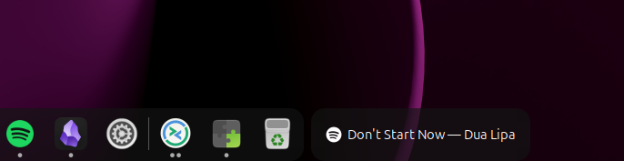
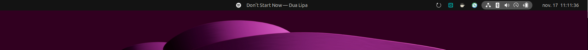

# Spotify Dock Controller

A GNOME Shell extension (GNOME 48–50, tested on 50.1 / Wayland) that controls Spotify through MPRIS.
It shows the current **title — artist** in a small indicator. Clicking the indicator opens a popup with:
- the album art;
- a progress bar you can click to seek;
- previous / play-pause / next buttons;
- shuffle and repeat.

You can put the indicator in the **top bar** (left, center or right) or **next to the dock**
(Ubuntu Dock / Dash to Dock), on its left or right side.

## Screenshots

**Next to the dock** (`placement = dock-right`)



**In the top bar** (`placement = panel-center`)



## Installation

```sh
make install          # gnome-extensions pack + install --force
```

To install by hand instead:
1. Copy the files to `~/.local/share/gnome-shell/extensions/spotify-dock-controller@lsarazin/`.
2. Run `glib-compile-schemas schemas/` in that folder.

## Enabling

On Wayland, GNOME Shell only detects a **newly installed** extension after you log out and back in.
After that, run:

```sh
gnome-extensions enable spotify-dock-controller@lsarazin
```

To see the logs, run `journalctl --user -f -o cat /usr/bin/gnome-shell`. Turn on *Placement logs*
(see below) if you also want the dock geometry.

## Options

Open the preferences with `gnome-extensions prefs spotify-dock-controller@lsarazin`, or from the
Extensions app. Every change applies immediately, without restarting the shell.
The preferences window is currently in French; this table gives the English meaning of each option.

| Group | Option | Values | Default | What it does |
|---|---|---|---|---|
| Placement | **Location** (`placement`) | Bottom, left of the dock · Bottom, right of the dock · Top bar — left · Top bar — center · Top bar — right | right of the dock | Where the indicator is shown. |
| Placement | **Position in the top bar area** (`panel-index`) | 0–50 | 0 | Order inside the chosen top bar box (0 = first). Only used for the top bar locations. |
| Placement | **Horizontal offset from the dock** (`dock-offset`) | −2000 to 2000 px | 8 | Gap between the dock and the widget. Only used for the dock locations. |
| Placement | **Hide in the Activities overview** (`hide-in-overview`) | on / off | off | Hides the floating dock widget while the overview is open. |
| Display | **Show “Title — Artist”** (`show-text`) | on / off | on | Shows the track text next to the icon. When off, only the icon is shown. |
| Display | **Maximum text length** (`max-text-length`) | 5–200 characters | 40 | Longer text is truncated with “…”. |
| Display | **Mini album art in the indicator** (`show-mini-art`) | on / off | off | Replaces the Spotify icon with a small cover once the art is available. |
| Display | **Hide when Spotify is closed** (`hide-when-closed`) | on / off | on | When off, the indicator stays visible but greyed out. |
| Interaction | **Middle click = play/pause** (`middle-click-play-pause`) | on / off | on | Middle-clicking the indicator toggles playback without opening the popup. |
| Advanced | **Placement logs** (`debug`) | on / off | off | Writes the dock geometry and placement details to the journal. |

You can also change any option from the command line:

```sh
gsettings --schemadir ~/.local/share/gnome-shell/extensions/spotify-dock-controller@lsarazin/schemas \
  set org.gnome.shell.extensions.spotify-dock-controller placement 'panel-center'
```

## How it works

- **Spotify detection**: the extension watches `org.mpris.MediaPlayer2.spotify` with `Gio.bus_watch_name` (NameOwnerChanged).
- **Playback position**: Spotify does not send updates for `Position`. While the popup is open, the extension reads it again every second with Properties.Get, and also listens to the `Seeked` signal. Shuffle and LoopStatus are read again each time the popup opens.
- **Seeking** uses `SetPosition(trackid, position)`.
- **Album art** is downloaded asynchronously with Soup 3 and cached in `~/.cache/spotify-dock-controller@lsarazin/<sha256(url)>`. The cache keeps at most 200 files.
- **Dock mode**:
  - The widget floats over the desktop. It is added with `Main.layoutManager.addChrome()`, so it reserves no screen space and is hidden in fullscreen.
  - It is aligned on the `dash-background` actor of the `dashtodockContainer`.
  - Its position is recomputed on `notify::allocation`, `monitors-changed` and `workareas-changed`, and when the dock is recreated.
  - In this mode the popup opens upwards.

## Tests

- `make check` validates the schema with `--strict` and checks the JS syntax.
- `tests/run-headless.sh` starts a fully isolated `gnome-shell --headless`: private D-Bus, temporary XDG/HOME, keyfile GSettings. It never writes to your real session.
  - The test environment contains Ubuntu Dock, a fake Spotify MPRIS player and album art served locally.
  - It checks placement, the popup, seeking, the buttons, real clicks through a virtual pointer, the preferences, and disable/enable.
  - It then saves screenshots.

## Known limitations

- **Dock detection**: it relies on internal Ubuntu Dock / Dash to Dock actor names (`dashtodockContainer`, `dash-background`). If a future version renames them, the widget falls back to the bottom center of the screen, plus the offset.
- **Dock orientation**: only a horizontal (bottom) dock is supported. With a vertical dock, the widget uses the same bottom-center fallback.
- **Monitors**: only the primary monitor is supported.
- **Blur My Shell**: it can make the dock transparent. The widget then keeps its own background.
- **GNOME versions**: only tested on GNOME Shell 50. Versions 48 and 49 are declared in `metadata.json`, but the code path used without `Clutter.ClickGesture` is untested.
